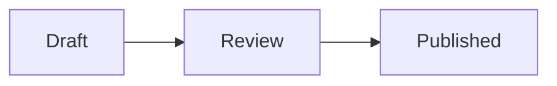

# M Note

A macOS markdown editor built with Electron, React, and Tiptap.


## Download

Download the latest macOS `.dmg` from the [GitHub Releases](https://github.com/younghoandrewchaa/m-note/releases) page.

## Features

- **Rich-text Markdown editing** powered by [`@younghoandrewchaa/yeditor`](packages/yeditor/README.md) — YAML frontmatter blocks, tables, task lists, syntax-highlighted code blocks, Mermaid diagram previews, in-document search, copy markdown, copy file path, and light/dark themes.
- **Native macOS tabs** — open `.md`/`.markdown` files from Finder, drag-and-drop, CLI arguments, or local Markdown links in native tabs (`Cmd+N` / `Cmd+T` for a new tab, `Cmd+W` to close, `Cmd+Shift+[` / `Cmd+Shift+]` to switch tabs). Already-open files focus their existing tab, untitled tabs prompt for a Save As location, unsaved tabs show a `●` prefix, and closing or quitting prompts to save dirty tabs.

## Mermaid diagrams

Choose **Mermaid** in a code block's language selector, or open Markdown containing a Mermaid fence:

````markdown

````

The source stays editable with a live diagram below it. Previews update after a short typing pause, match the light/dark theme, and work offline. Saving or choosing **Copy as… → Copy as Markdown** preserves the original Mermaid source.

Invalid or oversized diagrams show an error without discarding source. If an earlier valid preview remains visible, it is marked as stale. Diagram links and external images are disabled.

Rendering uses [Pele](https://pele.run/), whose layout differs from Mermaid.js. Mermaid theme colours, arbitrary HTML labels, and external Mermaid plugins are not supported; see [Pele's compatibility guide](https://pele.run/compatibility).

## App updates

Installed macOS builds check for updates automatically when the app launches. Click **Check for Updates** in the toolbar to check again. Available updates download inside the app; choose **Restart & Install** when ready. Unsaved notes are handled before the app closes, and open tabs (along with the active tab) are restored after restarting. If a check or download fails, use **Retry** or the toolbar icon. The app does not offer manual download links.

See [native update verification](docs/testing/native-updates.md) for the required installed-app acceptance test.

## Development

```bash
npm start   # Launch the Electron app with Vite HMR
npm test    # Run all tests (app + @younghoandrewchaa/yeditor)
npm run lint
```

The reusable React editor lives in the [`packages/yeditor`](packages/yeditor/README.md) workspace package (`@younghoandrewchaa/yeditor`).

## Scripts

### Release

Bump the version first if needed (`npm run patch` increments the patch version in `package.json` / `package-lock.json`), then run:

```bash
npm run release
# or with a custom release note:
npm run release -- "What's new in this release"
```

Runs locally on macOS for the current version in `package.json`:

1. **Test** — runs `npm test`
2. **Build** — builds the signed and notarized macOS `.dmg` and update `.zip` via `electron-forge make`
3. **Validate** — checks the update ZIP, versioned architecture manifests (`update.json`, `update-darwin-<arch>.json`, `RELEASES.json`), code signature, signing identity, and notarization assessment (`spctl`)
4. **Tag & upload** — creates and pushes the `vX.Y.Z` tag (if not already tagged) and uploads the artifacts to a draft GitHub release
5. **Verify & publish** — downloads the uploaded artifacts, verifies the ZIP checksum and metadata, and publishes the release

### Build DMG (local only)

```bash
npm run build:dmg
```

Builds the macOS DMG without publishing. Useful for local testing.

## License

[MIT](LICENSE)
